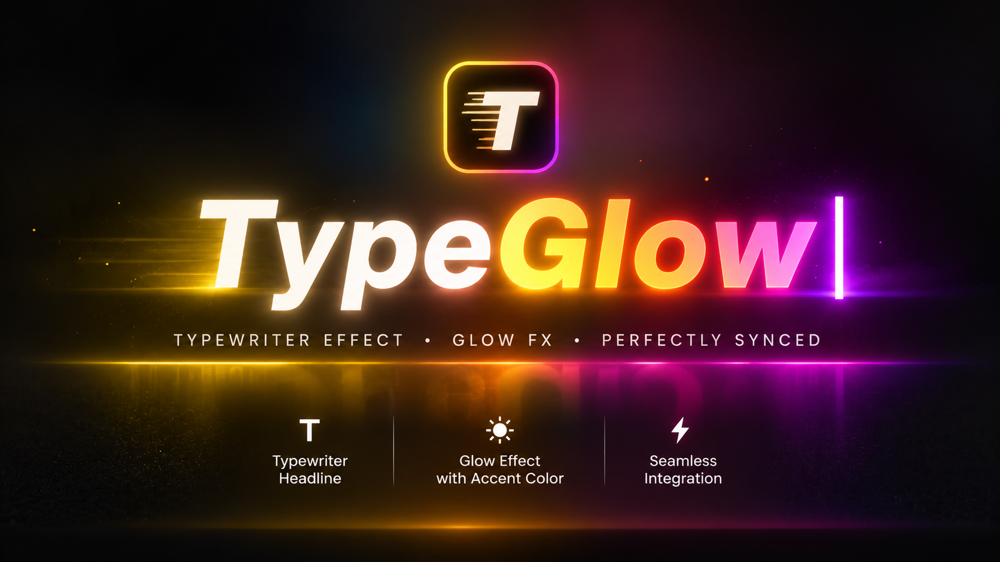

# Type Glow

Desktop plugin for Hermes. Renames the empty-chat headline, adds a **GlowFX** that
follows the accent colour, and a **typewriter** effect. **Clicking the headline**
opens the settings dialog (name, glow, typewriter, reset to original).

The UI follows the app language (English / German) via plugin-scoped locale
bundles (`ctx.i18n.register` + `usePluginI18n`).

## Surfaces

- `CHAT_EMPTY_AREA` (Desktop plugin SDK) for existing empty sessions.
- Intro-splash bridge: the core first-run splash is not a contribution area, so
  the plugin polls it (`ctx.setInterval`, no `MutationObserver`) and restyles the
  headline. Selectors are assembled at runtime, and the slot usage is disclosed
  here and in the PR.
- Plugin storage: `hermes.plugin.type-glow.*` (name / glow / typewrite).

## Disclosure (catalog rule 13)

- No network calls.
- No reads outside the plugin's own storage and the app's public theme values.
- No shell commands, no background processes, no credentials.
- The one move outside the documented SDK contribution areas: the plugin reads and
  restyles the app's intro-splash markup (see above). A proper SDK hook is requested
  in NousResearch/hermes-agent#158325.

## Install

`hermes plugins install type-glow`
